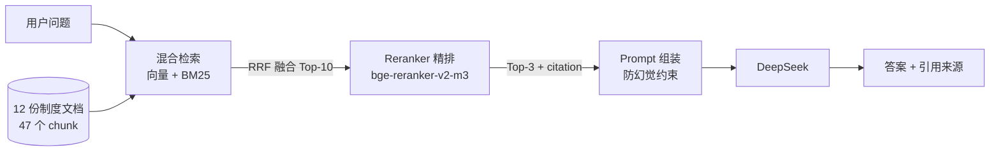

# 📚 企业知识库问答系统（RAG）

基于**检索增强生成**的制度问答系统：答案必须能指出「哪份文件 · 第几条」，资料里没有就说不知道。

不是"套一个 LLM 聊天框"，而是把**检索质量当工程问题来测、来量**——
100 条逐条核验的测试集、三种方案的检索指标、失败案例归因，全部可复现。

---

## 当前状态（诚实版）

| 项 | 状态 |
|---|---|
| 自动化测试 | 61 个 pytest 用例通过（不加载模型、不联网，约 45 秒） |
| 检索评测 | 100 条核验测试集（6 类），三方案对比已完成，见 [评测报告](docs/评测报告-v3.md) |
| 端到端 | `/ask`、`/documents`、上传/删除 + 自动重建（失败回滚）已实测，见 [演示记录](docs/演示记录.md) |
| 生成质量 | 定性抽查 + 历史 50 条集 LLM-as-judge；**100 条集的生成侧评测未做** |
| Docker | `Dockerfile` 存在但**未验证可跑** |

---

## 1. 它解决什么问题

直接问大模型「婚假几天」，它会编一个数字。企业制度问答的真实要求是：

1. **可溯源**：答案要能点开原文（`03-请假管理制度.txt · 第五条`）
2. **宁缺勿编**：知识库没写就拒答，而不是"合理地猜"
3. **定位准**：不只是"这份制度里有"，而是"第几条"

## 2. 链路

```
问题 → 混合检索（向量 Top-10 + BM25 Top-10 → RRF 融合）→ Reranker 精排 Top-3
     → prompt（带 [来源：文件 · 第X条]）→ DeepSeek 生成 → 答案 + 引用
```



详细架构、时序图见 [docs/架构.md](docs/架构.md)；逐模块代码讲解见 [docs/代码导读.md](docs/代码导读.md)。

## 3. 效果（100 条测试集，90 条有答案）

**条款级 Recall@1**（文件名 **且** 条款号都对，是最严格的口径）：

| 方案 | Recall@1 | Recall@3 | MRR | 单次检索耗时（CPU） |
|---|---|---|---|---|
| A 纯向量 | 52.2% | 74.4% | 0.658 | 26 ms |
| B 混合检索（RRF） | 73.3% | 92.2% | 0.835 | 25 ms |
| **C 混合 + Reranker（生产链路）** | **94.4%** | **98.9%** | **0.967** | 6111 ms |

要点：
- 混合检索比纯向量 **+21.1pp**，且不增加延迟 → 纯赚
- rerank 再 **+21.1pp**，代价是 240 倍延迟（CPU）→ 明确的取舍，不是免费的
- rerank 只提升"排序"，**R@10 从 B 起就是 100%**：召回池决定上限
- 相似条款辨析类（同一件事在两份制度里各写一遍）纯向量 R@1 只有 33%，加 rerank 到 100%

完整数据、分类型指标、失败案例归因、无答案拒答阈值实验：**[评测报告](docs/评测报告-v3.md)**

## 4. 快速开始

```bash
# 1) 依赖
pip install -r requirements.txt          # 开发/测试：requirements-dev.txt

# 2) 模型（二选一）
#    ① 下载到仓库 models/ 下（.env.example 默认指向这里）
modelscope download --model iic/nlp_gte_sentence-embedding_chinese-small --local_dir models/gte-small
modelscope download --model BAAI/bge-reranker-v2-m3 --local_dir models/bge-reranker-v2-m3
#    ② 或直接把 EMBEDDING_MODEL / RERANK_MODEL 设成模型 ID

# 3) 配置（.env 不进 git，密钥只放这里或系统环境变量）
cp .env.example .env
#   编辑 .env：DEEPSEEK_API_KEY=sk-xxx，EMBEDDING_MODEL / RERANK_MODEL

# 4) 配置自检（有问题会直接告诉你改哪个变量）
python config.py
```

三种用法：

```bash
python rag_qa.py          # 命令行问答
python run_server.py      # API + 网页（http://127.0.0.1:8000，页面自带上传/删除）
streamlit run rag_app.py  # Streamlit 界面
```

## 5. 接口

| 方法 | 路径 | 说明 |
|---|---|---|
| POST | `/ask` | `{"question": "..."}` → `{answer, sources[], timings}` |
| GET | `/health` | 配置问题、检索器状态、文档数/chunk 数 |
| GET | `/documents` | 文档列表（名称/大小/修改时间） |
| POST | `/documents/upload` | 上传 txt/md/pdf/docx → 自动重建；**重建失败自动回滚** |
| DELETE | `/documents/{name}` | 删除 → 自动重建；**重建失败自动恢复文件** |

接口文档：<http://127.0.0.1:8000/docs>

## 6. 评测怎么跑

```bash
python verify_eval_set.py     # 测试集门禁：条款号存在 + evidence 能在原文逐字命中
python eval_v3.py             # 三方案对比（约 12 分钟，主要在 CPU 精排）
python eval_v3.py --no-rerank # 只跑 A/B（约 40 秒）
python -m pytest              # 61 个用例：配置/清洗/加载/检索融合/API/精排降级
```

测试集：`eval_set_v3.json`（100 条 = 普通事实 25 / 条款编号 15 / 数字金额时间 20 /
相似条款辨析 15 / 跨文档 15 / 无答案 10），每条带文件名 + 条款号 + 原文摘录。

## 7. 工程化做了什么

- **配置集中**：`config.py` 唯一入口；模型路径与密钥走环境变量，换机器只改 `.env`；
  启动自检一次列出所有问题（并给出改法）
- **异常可读**：解析失败/模型缺失/配置错误都返回"原因 + 怎么修"，不裸抛 500
- **数据一致性**：上传先落临时文件再原子替换；重建失败回滚文件、保留旧索引
- **离线安全**：本地模型目录自动关闭 HF 联网校验（否则无网环境会卡十几分钟）
- **日志分级**：`LOG_LEVEL=INFO/DEBUG`；检索耗时、重建耗时、降级原因都有记录
- **可降级**：reranker 不可用 → 自动退回混合检索排序，服务不中断（`USE_RERANK=0` 可强制关闭）

## 8. 目录

```
config.py              配置中心          rag_qa.py        链路编排 + CLI
rag_api.py             FastAPI 服务      run_server.py    启动脚本
hybrid_retriever.py    混合检索 RRF      rerank.py        精排（可降级）
smart_loader.py        多格式加载        clean_pipeline.py 文本清洗
知识库/                12 份制度文档     static/index.html 问答页面
eval_set_v3.json       100 条测试集      eval_v3.py       三方案评测
verify_eval_set.py     测试集门禁        tests/           61 个 pytest 用例
docs/                  架构/代码导读/技术方案/评测报告/演示记录/规划
```

## 9. 已知问题与规划

见 [docs/已知问题与规划.md](docs/已知问题与规划.md)。最要紧的三条：
1. CPU 上精排 6.1 s/次，是端到端延迟的主要来源
2. 语料只有 47 个 chunk，R@10 已接近饱和，评测灵敏度有限
3. 100 条集的**生成侧**评测还没做（本轮只做检索侧）

## 10. 文档索引

| 文档 | 给谁看 |
|---|---|
| [docs/代码导读.md](docs/代码导读.md) | 想读懂代码、要能讲清链路的人（含自查清单、练手任务） |
| [docs/架构.md](docs/架构.md) | 关心模块划分、时序、部署形态的人 |
| [docs/技术方案.md](docs/技术方案.md) | 关心"为什么这么选"和证据的人 |
| [docs/评测报告-v3.md](docs/评测报告-v3.md) | 关心数字是否可信、失败在哪的人 |
| [docs/演示记录.md](docs/演示记录.md) | 想直接看真实运行输出的人 |
| [docs/已知问题与规划.md](docs/已知问题与规划.md) | 关心后续路线与边界的人 |
