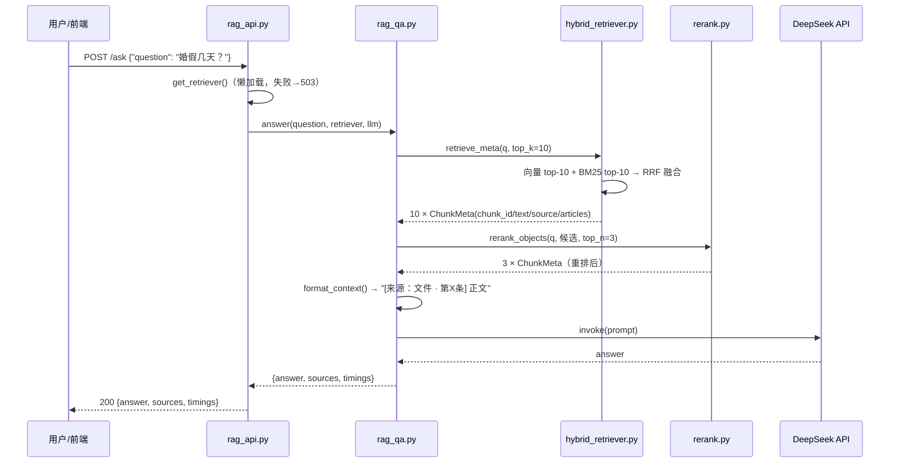
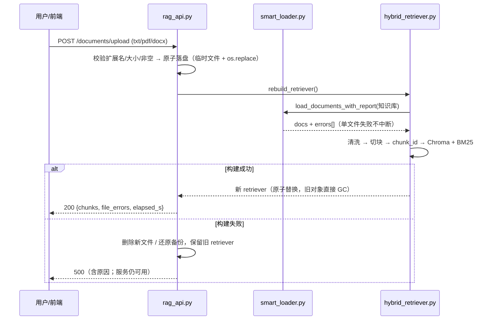

# 项目架构

## 1. 组件与职责（谁负责什么）

| 模块 | 职责 | 关键接口 |
|---|---|---|
| `config.py` | 唯一配置入口：路径、模型、密钥、超参、日志、启动自检 | `check()` `assert_valid()` `describe()` `setup_logging()` |
| `smart_loader.py` | 多格式解析（txt/md/pdf/docx），坏文件带原因返回 | `load_file()` `load_documents_with_report()` |
| `clean_pipeline.py` | 文本清洗（换行/空白/不可见字符/重复行） | `clean_document()` |
| `hybrid_retriever.py` | 切块 + chunk_id + 向量索引 + BM25 索引 + RRF 融合 | `build_hybrid()` `retrieve_meta()` `dense_meta()` `bm25_meta()` |
| `rerank.py` | bge-reranker-v2-m3 精排，模型不可用时降级 | `rerank_objects()` `score_pairs()` |
| `rag_qa.py` | 链路编排：召回→精排→拼 prompt→生成；CLI 入口 | `answer()` `retrieve_and_rerank()` `build_prompt()` |
| `rag_api.py` | FastAPI：问答、文档管理、健康检查；重建串行化 + 失败回滚 | `/ask` `/documents` `/health` |
| `run_server.py` | 启动脚本（host/port 可配） | — |
| `eval_v3.py` | 100 条测试集三方案对比（检索侧，不烧 token） | `--no-rerank` `--limit N` |
| `verify_eval_set.py` | 测试集质量门禁：条款号存在、evidence 可在原文命中 | — |
| `tests/` | 55 个 pytest 用例（不加载模型、不联网） | `python -m pytest` |

## 2. 请求时序（问答）



## 3. 建库与文档变更时序



## 4. 部署视图（当前阶段刻意保持简单）

```
                        ┌─────────────────────────────┐
   浏览器 / curl ──────► │ uvicorn (单进程, 127.0.0.1) │
                        │  FastAPI app (rag_api)      │
                        └───────────┬─────────────────┘
                                    │ 进程内对象
        ┌───────────────────────────┼────────────────────────────┐
        ▼                           ▼                            ▼
  Chroma（内存态）            BM25（内存态）              bge-reranker（本地 torch）
  + GTE embedding（本地）               
                                    │
                                    ▼
                          DeepSeek API（外网，需 API key）
```

没有引入 Docker / 消息队列 / 向量数据库服务：知识库规模是 12 份文档、约 50 个 chunk，
进程内索引足够；重建一次 1-2 分钟，接口同步完成即可。**这是权衡后的选择，不是能力上限**。

## 5. 目录结构

```
rag-qa/
├── config.py                  # 配置中心（.env → 环境变量 → 默认值）
├── rag_qa.py                  # 链路编排 + CLI
├── rag_api.py                 # FastAPI 服务
├── run_server.py              # 启动脚本
├── hybrid_retriever.py        # 混合检索（RRF）+ chunk_id + Citation
├── rerank.py                  # 精排（可降级）
├── smart_loader.py            # 多格式加载（带错误上报）
├── clean_pipeline.py          # 文本清洗
├── query_rewrite.py           # Multi-Query（评测后未集成，保留实验）
├── 知识库/                    # 12 份制度文档（txt）
├── static/index.html          # 问答页面
├── eval_set_v3.json           # 100 条核验测试集（本轮新增）
├── eval_v3.py                 # 三方案对比评测（本轮新增）
├── eval_results_v3.json       # 评测原始结果（本轮产出）
├── verify_eval_set.py         # 测试集质量门禁（本轮新增）
├── eval_*.py                  # 历史实验脚本（chunk/RRF/召回池/Ragas…）
├── tests/                     # 55 个 pytest 用例（本轮新增）
├── docs/                      # 架构 / 代码导读 / 技术方案 / 评测报告
├── .env.example               # 配置模板（.env 不进 git）
├── requirements.txt
└── Dockerfile                 # 未验证（诚实标注）
```
